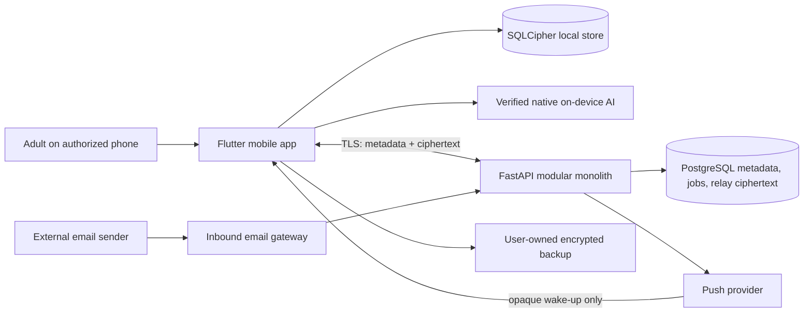

# System architecture

Status: Stage 2 calendar, identity, authorization, and encrypted synchronization
are implemented under ADR-019 through ADR-022. Stage 3 components shown in the
context diagram remain future boundaries.

## System context

## Trust boundaries

1. **Authorized device:** private family content is decrypted and processed here.
   Local persistent content is encrypted with SQLCipher; sensitive keys use
   platform-protected storage and device authentication where available.
2. **Sarti server:** authenticates devices, authorizes family resources, relays
   ciphertext, keeps operational metadata, and runs PostgreSQL-backed jobs. It
   must not persist decrypted family content.
3. **External email boundary:** ordinary email is plaintext during receipt and
   initial gateway processing. The exact minimization and encryption transition
   must be designed before this feature is built.
4. **External delivery services:** push providers receive opaque notification
   data only. User-owned backup storage receives ciphertext only.

## Components

### Flutter application

Owns presentation, Riverpod state, local domain operations, offline commands,
local notifications, encryption/decryption, key handling, synchronization, and
on-device AI. iOS and Android are supported targets.

### FastAPI modular monolith

Owns passkey authentication support, active-device enforcement, authorization,
family membership metadata, encrypted relay operations, retention, backup
coordination metadata, email intake orchestration, push wake-ups, deletion and
export coordination, and operational administration.

Modules live in one deployable process but communicate through explicit module
interfaces. Direct cross-module table access is prohibited unless documented.

### PostgreSQL

Stores operational metadata, authorization relationships, registered device
state, job state, audit-safe events, and encrypted relay envelopes. Relay
ciphertext expires after seven days. The schema must prevent or make detectable
cross-family access.

### Local encrypted store

SQLite with SQLCipher is the device source of truth for decrypted application
state. The schema and migration process must support offline operation and safe
recovery from interrupted migrations.

## Primary data flows

### Local change and synchronization

1. The user changes local state.
2. The app commits the change to the encrypted local database.
3. The app creates a resource-scoped encrypted sync operation.
4. The server authenticates the device, authorizes its metadata scope, and stores
   ciphertext without learning family content.
5. Another authorized device downloads and authenticates the operation, resolves
   conflicts deterministically, and commits it locally.

ADR-020 and ADR-021 define the envelope, authenticated metadata, algorithms,
rotation, replay protection, ordering, and explicit conflict semantics.

### AI suggestion

1. The app invokes a verified native on-device capability.
2. If unavailable or invalid, it uses a deterministic local parser.
3. The result is validated against a strict local schema and displayed as a
   proposal.
4. Only explicit confirmation writes the change.

### Push notification

The server sends an opaque wake-up or generic notification. After waking, the app
downloads ciphertext and renders content locally. Sensitive names, event details,
and family identifiers must not be placed in the provider-visible payload.

### Incoming email

Email is unavoidably plaintext before and during initial gateway processing. The
gateway must minimize retention, isolate untrusted content, resist instruction
injection, and convert useful data into an encrypted suggestion for explicit
approval. Provider selection and the implementable encryption transition remain
open decisions.

## Deployment

Docker is the local development standard. Production hosting is intentionally
undecided. Deployment selection requires a separate ADR covering regions,
subprocessors, cost, availability, key custody, backup, monitoring, and deletion.

## Cross-cutting constraints

- One active authorized phone per adult, enforced by the backend.
- Role and resource authorization applies to every server operation.
- Server observability contains operational identifiers and bounded metrics only.
- Background work uses PostgreSQL-backed jobs.
- Export and deletion are user controlled.
- Calendar exports are deferred and would leave the E2EE boundary.

## Dependency direction

Domain code must not depend on UI, transport, persistence, native AI, or provider
implementations. Adapters implement interfaces owned by application/domain
layers. Backend modules expose services rather than importing one another's
repositories.

## Supporting designs

- [System and component context](SYSTEM-CONTEXT.md)
- [Data flows](DATA-FLOWS.md)
- [Device identity](DEVICE-IDENTITY.md)
- [Key management](KEY-MANAGEMENT.md)
- [Tenant isolation](TENANT-ISOLATION.md)
- [Offline synchronization](OFFLINE-SYNC.md)
- [API conventions](../api/CONVENTIONS.md)
- [Local database](../database/LOCAL-DATABASE.md)
- [Server database](../database/SERVER-DATABASE.md)
- [Error handling](../engineering/ERROR-HANDLING.md)
- [Dependency governance](../engineering/DEPENDENCY-GOVERNANCE.md)
- [Threat model](../security/THREAT-MODEL.md)
