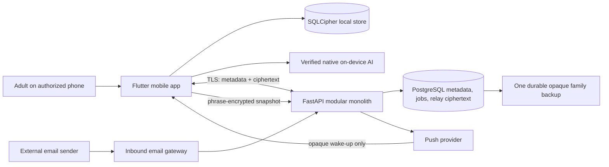

# System architecture

Status: Stage 2 calendar, identity, authorization, and encrypted synchronization
are implemented under ADR-019 through ADR-022. The Stage 3 native event-proposal
path is integrated under ADR-029; other Stage 3 acceptance gaps remain in
`docs/STATUS.md`.

## System context

## Trust boundaries

1. **Authorized device:** private family content is decrypted and processed here.
   Local persistent content is encrypted with SQLCipher; sensitive keys use
   platform-protected storage and device authentication where available.
2. **Sarti server:** authenticates devices, authorizes family resources, relays
   ciphertext, keeps operational metadata, and runs PostgreSQL-backed jobs. It
   must not persist decrypted family content.
3. **External email boundary:** ordinary email is plaintext during receipt and
   initial gateway processing. The exact minimization and encryption transition
   must be designed before this feature is built.
4. **External delivery services:** push providers receive opaque notification
   data only. User-owned backup storage receives ciphertext only.

## Components

### Flutter application

Owns presentation, Riverpod state, local domain operations, offline commands,
local notifications, encryption/decryption, key handling, synchronization, and
on-device AI. iOS and Android are supported targets.

ADR-033 uses a pinned Kalender widget behind a presentation adapter for spatial
day/week/month layouts. Domain occurrences remain generated by Sarti, with
elapsed duration, IANA display timezone and read-only layout objects. Navigation
and layout never persist content; tapping opens the existing explicit editor.

### FastAPI modular monolith

Owns passkey authentication support, active-device enforcement, authorization,
family membership metadata, encrypted relay operations, retention, backup
coordination metadata, email intake orchestration, push wake-ups, deletion and
export coordination, and operational administration.

Modules live in one deployable process but communicate through explicit module
interfaces. Direct cross-module table access is prohibited unless documented.

### PostgreSQL

Stores operational metadata, authorization relationships, registered device
state, job state, audit-safe events, and encrypted relay envelopes. Relay
ciphertext expires after seven days. The schema must prevent or make detectable
cross-family access.

### Local encrypted store

SQLite with SQLCipher is the device source of truth for decrypted application
state. The schema and migration process must support offline operation and safe
recovery from interrupted migrations.

## Primary data flows

### Local change and synchronization

1. The user changes local state.
2. The app commits the change to the encrypted local database.
3. The app creates a resource-scoped encrypted sync operation.
4. The server authenticates the device, authorizes its metadata scope, and stores
   ciphertext without learning family content.
5. Another authorized device downloads and authenticates the operation, resolves
   conflicts deterministically, and commits it locally.

ADR-020 and ADR-021 define the envelope, authenticated metadata, algorithms,
rotation, replay protection, ordering, and explicit conflict semantics.
ADR-034 versions metadata encoding: new operations use deterministic protocol 2,
while legacy ciphertext remains unchanged and decoding fails closed.

### AI suggestion

1. The deterministic parser produces a local partial proposal.
2. The app invokes Apple Foundation Models or Android ML Kit only after its
   native runtime reports the model available.
3. If unavailable, invalid, or failed, it retains the deterministic proposal.
4. Native output can fill unresolved fields only, is validated locally, and is displayed as a
   proposal.
5. Only explicit confirmation writes the change; the user can immediately undo.

### Push notification

The server sends an opaque wake-up or generic notification. After waking, the app
downloads ciphertext and renders content locally. Sensitive names, event details,
and family identifiers must not be placed in the provider-visible payload.

### Incoming email

Email is unavoidably plaintext before and during initial gateway processing. The
gateway must minimize retention, isolate untrusted content, resist instruction
injection, and convert useful data into an encrypted suggestion for explicit
approval. Provider selection and the implementable encryption transition remain
open decisions.

## Deployment

Docker is the local development standard. ADR-027 selects Cloud Run and Neon
Free for development and the initial private beta. Production hosting is
intentionally
undecided. Deployment selection requires a separate ADR covering regions,
subprocessors, cost, availability, key custody, backup, monitoring, and deletion.

## Cross-cutting constraints

- One active authorized phone per adult, enforced by the backend.
- Role and resource authorization applies to every server operation.
- Server observability contains operational identifiers and bounded metrics only.
- Background work uses PostgreSQL-backed jobs.
- Export and deletion are user controlled.
- Calendar exports are deferred and would leave the E2EE boundary.

## Dependency direction

Domain code must not depend on UI, transport, persistence, native AI, or provider
implementations. Adapters implement interfaces owned by application/domain
layers. Backend modules expose services rather than importing one another's
repositories.

## Supporting designs

ADR-032 adds a durable, owner-authorized encrypted backup snapshot to PostgreSQL.
The app explicitly uploads a v2 SQLCipher snapshot/key envelope; an empty new
installation downloads it after passkey login and asks for the recovery phrase.
This blob is separate from expiring sync operations and is never decrypted by
the backend. See `docs/api/BACKUP-RECOVERY.md` for the API and activation protocol.

- [System and component context](SYSTEM-CONTEXT.md)
- [Data flows](DATA-FLOWS.md)
- [Device identity](DEVICE-IDENTITY.md)
- [Key management](KEY-MANAGEMENT.md)
- [Tenant isolation](TENANT-ISOLATION.md)
- [Offline synchronization](OFFLINE-SYNC.md)
- [API conventions](../api/CONVENTIONS.md)
- [Local database](../database/LOCAL-DATABASE.md)
- [Server database](../database/SERVER-DATABASE.md)
- [Error handling](../engineering/ERROR-HANDLING.md)
- [Dependency governance](../engineering/DEPENDENCY-GOVERNANCE.md)
- [Threat model](../security/THREAT-MODEL.md)
- [AI architecture](../ai/AI-ARCHITECTURE.md)
- [Native AI compatibility](../ai/DEVICE-COMPATIBILITY.md)

Child-profile synchronization implements ADR-020/021/022 through an atomic local
outbox, stable per-child resource IDs, explicit owner sharing consent, an
authorized public-key directory, signed sealed-box key exchange, and resource-kind
validation before decrypted application. See
[child profile components and flow](CHILD-PROFILE-SYNC.md). Private names, colours
and aliases remain inside SQLCipher and child-resource ciphertext.

ADR-035 connects guardian share/copy/QR invitations to explicit pinned-device
approval, resource-scoped key grants and encrypted initial state. Metadata-only
membership baselines avoid missing-key pre-enrollment relay history. See
[Guardian onboarding](../api/GUARDIAN-ONBOARDING.md) for trust boundaries, flow,
permissions, rollout and physical-platform validation limits.

## Optional cloud AI privacy — ADR-036

The separate optional adapter uses a bounded JSON scheduling-token array and
fresh per-request labels. Stored aliases, requester/account/family/device IDs,
raw sentences and reverse mappings are excluded. Unsupported input remains
local. Consent version 2 requires new opt-in. Scheduling and provider/network
metadata can still be identifying; pseudonymization is not anonymity. The
shipping bootstrap remains local/native; safe credential delivery and live
provider validation are still BUG-005. No backend cloud broker is introduced.
Public copy follows `../product/PRIVACY-MESSAGING.md`.

## Adult-private calendar extension (ADR-038)

Accepted 2026-10-13. Household and adult-private calendars have distinct resource
IDs and keys. A household owner has no implied access to another adult's private
resource. Explicit sharing queues a separate household copy atomically with the
private write; the private mapping never enters that copy. Typed adult/pet profile
references augment existing child assignments. See
`../product/ADULT-AND-PET-APPOINTMENTS.md` and ADR-038 for exact sharing, recovery,
revocation and deployment compatibility boundaries.
