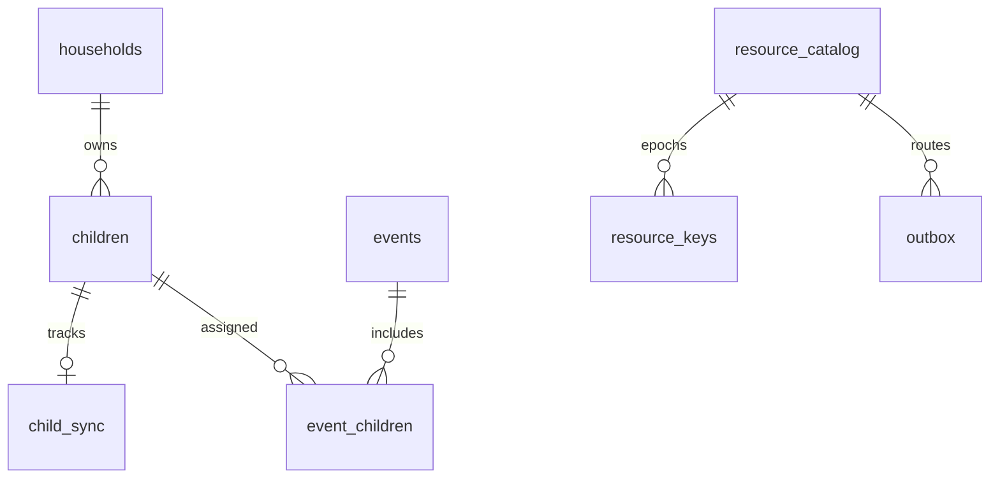
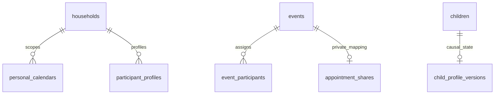
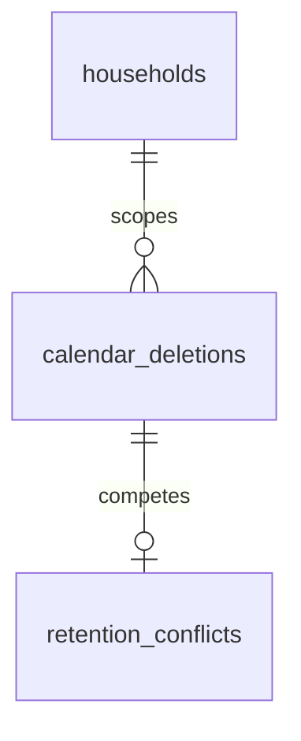
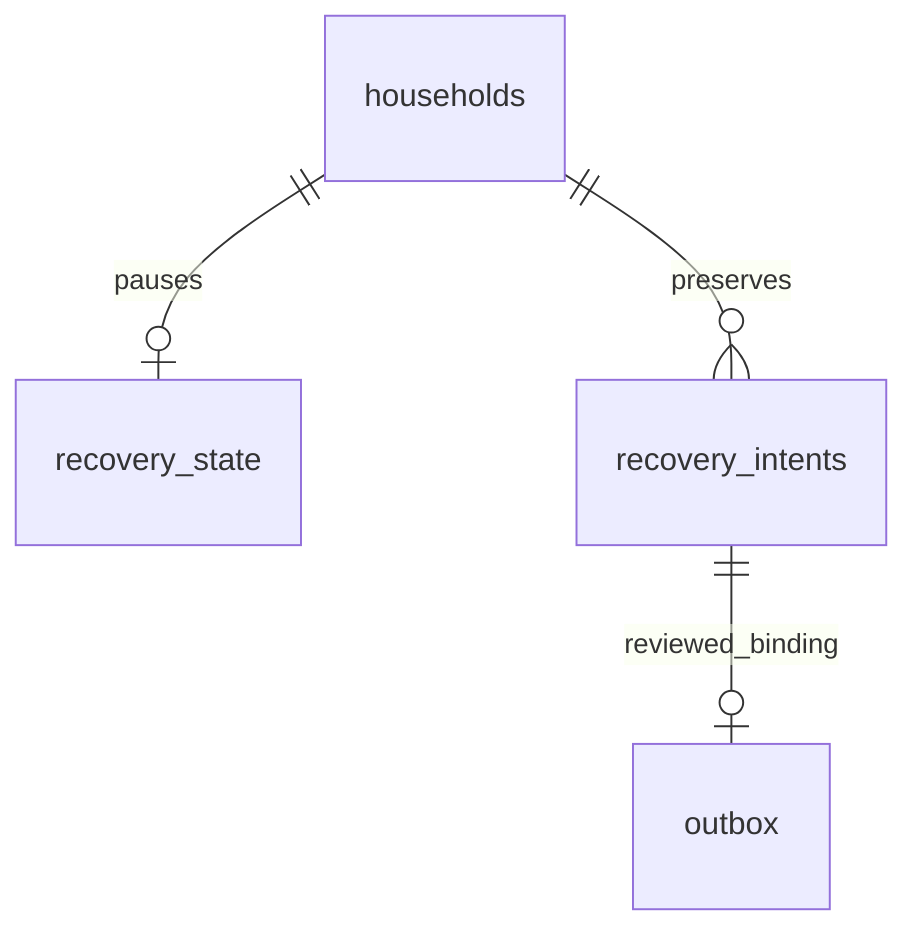

# Local SQLCipher database

Schema version 9 opens only after a 32-byte key is applied and
`PRAGMA cipher_version` succeeds. Foreign keys are enabled before migrations.
Migrations run under `BEGIN IMMEDIATE` and roll back on failure.

| Table | Purpose / notable constraints |
| --- | --- |
| `households` | Local family name and stable calendar resource UUID |
| `guardians` | Local encrypted display profiles, family FK |
| `children` | Encrypted name, cloud alias, and ARGB calendar colour; alias is unique per family; hidden placeholders preserve authorized calendar assignments without disclosing an unreadable profile |
| `events` | Title/notes, IANA zone, local start, duration, status, recurrence, pickup/dropoff, revision, tombstone |
| `event_versions` | Last applied version vector per event for causal edits |
| `event_children` | Many-to-many event assignment, cascading FKs |
| `reminders` | Non-negative minutes before event |
| `outbox` | Atomic local operations with UUID, resource, plaintext inside SQLCipher, version vector, pending/uploaded state and persisted encrypted retry envelope |
| `applied_operations` | Durable download de-duplication |
| `conflicts` | Both concurrent alternatives and vectors; open/resolved state |
| `resource_keys` | Resource UUID plus monotonic epoch and key, inside SQLCipher |
| `sync_state` | Per-family server cursor and next author-device sequence |
| `resource_catalog` | Expected family/resource kind and current server key epoch; validates child/calendar dispatch |
| `child_sync` | Last published child epoch and explicit initial sharing choice; never inferred during migration |
| `app_preferences` | Versioned local settings, including explicit cloud-AI consent |

`ix_events_household_start` supports visible calendar range reads;
`ix_outbox_pending` supports ordered retry. Event children/reminders are replaced
atomically with an event. A remote event update restores these relationship rows.
The database file contains private content but is encrypted at rest; outbox JSON
becomes XChaCha20-Poly1305 ciphertext before leaving the device.

Local migration v4 adds `children.cloud_alias`, backfills existing profiles with
random opaque `child-<hex>` values, and creates a case-insensitive unique index
within each household. New profiles receive a friendly random alias or a locally
validated parent-selected alias. The alias-to-child relationship is not included
in synchronization metadata or cloud-AI requests.

Local migration v5 adds `app_preferences`. Cloud-AI consent uses a versioned key,
defaults to disabled when absent, and remains inside SQLCipher. A future material
disclosure change must use a new key so previous consent does not carry forward.

Local migration v6 adds `outbox.envelope_json`, `children.is_placeholder`,
`resource_catalog`, and `child_sync`. The envelope is stored before network I/O
so a lost receipt retries identical ciphertext. Legacy children are queued on
owner synchronization without inventing sharing consent. New child IDs are also
their child-resource UUIDs. Name, colour, and alias are encrypted under that
child's independent resource key. A calendar referencing a profile outside the
reader's permissions gets a hidden, nameless local placeholder, replaced only
by an authenticated child-resource operation. v5→v6 encrypted-file tests preserve
children, event assignments and pending writes and reject a wrong SQLCipher key.

`resource_catalog` relationships are logical validation relationships; they are
not SQL foreign keys. All of these tables remain inside SQLCipher.

BUG-011 requires no local schema migration (still v6). Persisted envelope JSON
now includes `protocolVersion`. An absent value means legacy 1; already-encrypted
pending bytes remain unchanged. New payloads use protocol 2. Old unknown-order
ciphertext is retained and cannot be silently applied/skipped.

BUG-004 retains schema v6. `app_preferences` stores encrypted role/calendar
access, family-profile vectors/readiness and handoff progress referencing outbox
operation IDs. `guardians` gains private names through an authenticated
family-profile payload; no new table or plaintext database is introduced.
Snapshots are resource-scoped outbox operations, not user event edits.

ADR-036 retains stored `cloud_alias` values for profile/schema compatibility but
excludes them from cloud payloads. Request labels/reverse mappings are temporary
memory objects; no label table is added. Consent uses `cloud_ai_consent_v2` in
existing encrypted preferences; v1 opt-in does not enable it. No migration.

## Local v7 — adult/pet appointments (ADR-038)

| Table | Purpose |
| --- | --- |
| `personal_calendars` | Adult UUID → household/personal resource UUID; one local family per adult |
| `participant_profiles` | Encrypted typed adult/pet names, colours, adult reference and causal vector |
| `event_participants` | Typed adult/pet references without changing existing event/child columns |
| `appointment_shares` | Private/shared event mapping and reviewed household vector; never relayed |
| `child_profile_versions` | Durable child-profile causal vectors, preserved across validated family/personal recovery |

v7 creates new tables atomically and preserves existing events, pending envelopes,
keys, IDs and colours. No old profiles are silently recoloured. Child colour edits
reuse the child resource with versioned `child_updated` operations; concurrent
identical snapshots merge vectors, differing edits fail closed for review.
Private event queries/conflicts include only the current bound adult's resource.
A local draft identity lives in encrypted preferences until its first authenticated
binding; it cannot rebind a previously published adult identity.

## Local v8 — mobile retention (ADR-039)

`calendar_deletions(event_id,household_id,resource_id,vector_json,deleted_at)`
retains causal/replay protection without appointment content. `retention_conflicts`
preserves the minimized deletion plus competing encrypted local event/vector for
explicit review. Policies use SQLCipher preferences; `event_versions.retention_keep_vector` stores
the reviewed Keep exception as recoverable causal state. Editing resets that
exception; matching handoff snapshots retain it through `retention_kept`.
Expired content/relationships and obsolete uploaded payloads are removed under
a transaction; exact pending retry envelopes are preserved. `secure_delete=ON`
clears deleted database cells; forensic erasure of external copies is not claimed.
Migration adds tables atomically without deleting events or changing old colours,
keys, vectors or pending envelopes. Restore pauses and backup exclusion follow
existing family/private scope.

The conflict relationship is logical, not a foreign key: the competing event
may still exist instead of a committed local deletion.

## Local v9 — family recovery continuation (ADR-040 / BUG-022)

`recovery_state` holds family, phase, encrypted snapshot time, household causal
vector and bounded reason. Phases: snapshot, paused, catching_up, review, ready,
blocked. `recovery_intents` holds source provenance UUID, family/resource/kind,
original payload/vector, pending/quarantined/queued/done status, fresh queued
operation mapping, reason and exact reviewed payload/vector. All live in SQLCipher;
no recovery plaintext is added to PostgreSQL, telemetry or push payloads.

v8→v9 adds tables atomically, preserving keys, vectors, applied IDs and pending
envelopes. Existing stripped family-recovery markers become blocked; migration
never fabricates lost history or sweeps appointments. Snapshot staging validates
family scope before activation and resets former device operation bindings.

The outbox link is logical: old outbox rows reset on replacement; provenance
remains independently protected. See recovery migration/security tests.

Calendar retention also removes completed recovery-intent bodies for the deleted
entry; unresolved/quarantined intent and exact pending retries are protected.
RECOVERY-RETENTION-001 verifies this minimization boundary.

Reconciliation discards completed intent rows after a receipt or proven causal
domination (including downloaded deletion). Durable applied IDs and minimal
deletion state provide replay protection without retaining obsolete bodies.

## Local v10 — scoped state and device-wide ordering (ADR-041 foundation)

`personal_calendars` now has composite `(adult_id, household_id)` identity while
resource IDs remain unique. Migration preserves existing rows, ciphertext keys,
vectors, exact pending outbox envelopes and per-household relay cursors.
`device_sync_state(device_id,next_device_sequence)` is the authoritative device
upload counter. The authenticated engine initializes it from existing sequence
high-water marks; it never renumbers a pending encrypted operation. The legacy
per-family sequence column remains migration evidence, not independent authority.

The encrypted selected-household preference chooses unpinned repository reads;
`forHousehold(id)` pins async work and child/private/event/recovery queries to a
specific local household. Unknown selection fails. Engines serialize uploads
across contexts sharing the database. A persisted uncertain upload blocks a new
context's upload until its exact original envelope is retried; ciphertext is not
silently discarded or resequenced. Recovery activation clears former device
counter state. Native UI switching and the multi-context runtime still need wiring.

Household snapshot export sanitizes an encrypted copy to one household, strips
foreign resource/catalog/keys/conflicts/outbox/cursor/content, and strips private
resources unless explicitly exporting the author scope. Device-global receipts
unattributable to this snapshot are excluded; causal event/profile vectors and
protected recovery intent remain. Live data is not changed. Scoped import into
an occupied store remains pending and fails safely through the existing empty-
store guard. No multi-household restore acceptance is claimed.
