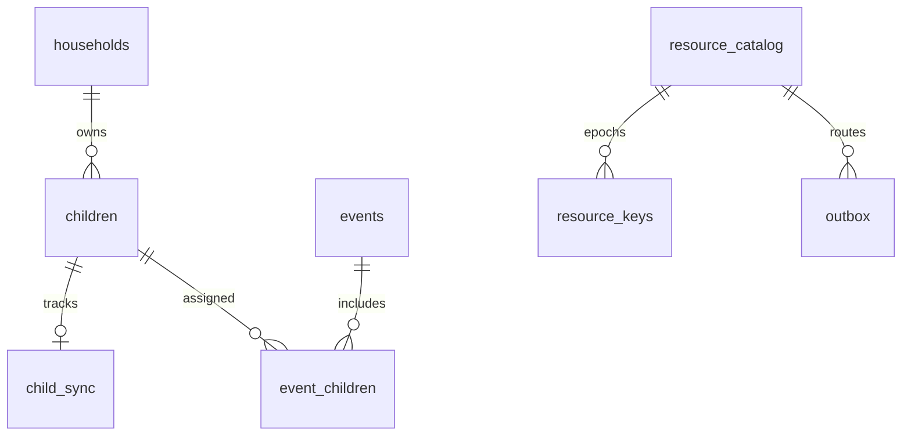

# Local SQLCipher database

Schema version 6 opens only after a 32-byte key is applied and
`PRAGMA cipher_version` succeeds. Foreign keys are enabled before migrations.
Migrations run under `BEGIN IMMEDIATE` and roll back on failure.

| Table | Purpose / notable constraints |
| --- | --- |
| `households` | Local family name and stable calendar resource UUID |
| `guardians` | Local encrypted display profiles, family FK |
| `children` | Encrypted name, cloud alias, and ARGB calendar colour; alias is unique per family; hidden placeholders preserve authorized calendar assignments without disclosing an unreadable profile |
| `events` | Title/notes, IANA zone, local start, duration, status, recurrence, pickup/dropoff, revision, tombstone |
| `event_versions` | Last applied version vector per event for causal edits |
| `event_children` | Many-to-many event assignment, cascading FKs |
| `reminders` | Non-negative minutes before event |
| `outbox` | Atomic local operations with UUID, resource, plaintext inside SQLCipher, version vector, pending/uploaded state and persisted encrypted retry envelope |
| `applied_operations` | Durable download de-duplication |
| `conflicts` | Both concurrent alternatives and vectors; open/resolved state |
| `resource_keys` | Resource UUID plus monotonic epoch and key, inside SQLCipher |
| `sync_state` | Per-family server cursor and next author-device sequence |
| `resource_catalog` | Expected family/resource kind and current server key epoch; validates child/calendar dispatch |
| `child_sync` | Last published child epoch and explicit initial sharing choice; never inferred during migration |
| `app_preferences` | Versioned local settings, including explicit cloud-AI consent |

`ix_events_household_start` supports visible calendar range reads;
`ix_outbox_pending` supports ordered retry. Event children/reminders are replaced
atomically with an event. A remote event update restores these relationship rows.
The database file contains private content but is encrypted at rest; outbox JSON
becomes XChaCha20-Poly1305 ciphertext before leaving the device.

Local migration v4 adds `children.cloud_alias`, backfills existing profiles with
random opaque `child-<hex>` values, and creates a case-insensitive unique index
within each household. New profiles receive a friendly random alias or a locally
validated parent-selected alias. The alias-to-child relationship is not included
in synchronization metadata or cloud-AI requests.

Local migration v5 adds `app_preferences`. Cloud-AI consent uses a versioned key,
defaults to disabled when absent, and remains inside SQLCipher. A future material
disclosure change must use a new key so previous consent does not carry forward.

Local migration v6 adds `outbox.envelope_json`, `children.is_placeholder`,
`resource_catalog`, and `child_sync`. The envelope is stored before network I/O
so a lost receipt retries identical ciphertext. Legacy children are queued on
owner synchronization without inventing sharing consent. New child IDs are also
their child-resource UUIDs. Name, colour, and alias are encrypted under that
child's independent resource key. A calendar referencing a profile outside the
reader's permissions gets a hidden, nameless local placeholder, replaced only
by an authenticated child-resource operation. v5→v6 encrypted-file tests preserve
children, event assignments and pending writes and reject a wrong SQLCipher key.

`resource_catalog` relationships are logical validation relationships; they are
not SQL foreign keys. All of these tables remain inside SQLCipher.

BUG-011 requires no local schema migration (still v6). Persisted envelope JSON
now includes `protocolVersion`. An absent value means legacy 1; already-encrypted
pending bytes remain unchanged. New payloads use protocol 2. Old unknown-order
ciphertext is retained and cannot be silently applied/skipped.

BUG-004 retains schema v6. `app_preferences` stores encrypted role/calendar
access, family-profile vectors/readiness and handoff progress referencing outbox
operation IDs. `guardians` gains private names through an authenticated
family-profile payload; no new table or plaintext database is introduced.
Snapshots are resource-scoped outbox operations, not user event edits.

ADR-036 retains stored `cloud_alias` values for profile/schema compatibility but
excludes them from cloud payloads. Request labels/reverse mappings are temporary
memory objects; no label table is added. Consent uses `cloud_ai_consent_v2` in
existing encrypted preferences; v1 opt-in does not enable it. No migration.
