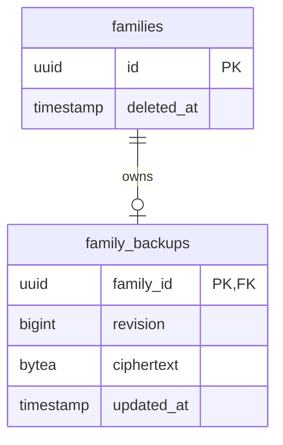
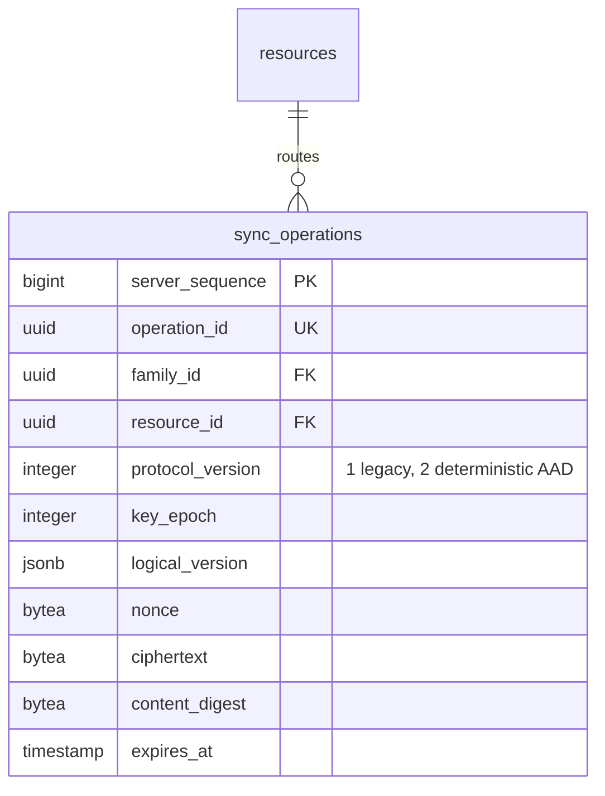
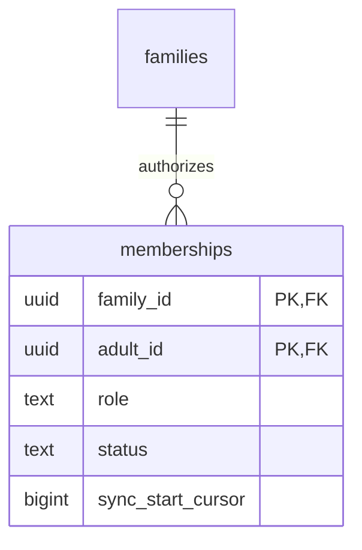
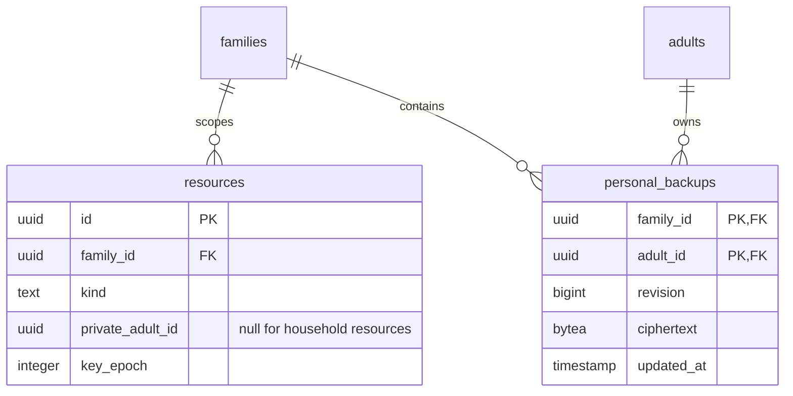

# PostgreSQL database

Migration `0001` creates `schema_metadata`. Migration `0002` creates:

| Area | Tables | Stored data |
| --- | --- | --- |
| Identity | `adults`, `webauthn_credentials`, `webauthn_challenges`, `sessions`, `devices` | Public credentials/keys, hashed tokens, expiry/state, counters |
| Tenant auth | `families`, `memberships`, `resources`, `resource_permissions`, `guardian_invitations` | Opaque UUIDs, roles, permission levels, hashed invite token, key epoch |
| Encryption relay | `resource_key_grants`, `sync_operations` | Signed sealed keys, authenticated routing metadata, opaque ciphertext, seven-day expiry |

Foreign keys, enum-like checks, unique invitation/operation constraints, positive
sequence/epoch constraints, and a partial unique index enforce one active device
per adult. Relay operations are indexed by family/server sequence and expiry.
The schema contains no family names, event titles, notes, child names, colours,
pickup details, reminders, or resource keys in decryptable form.

Migration `0003` adds opaque push tokens, hashed family email routing tokens,
and the initial suggestion table. Migration `0004` removes all email content
columns and adds `email_suggestion_deliveries`, which contains a recipient device
ID, libsodium sealed-box ciphertext, delivery state, and timestamps. The server
cannot decrypt these per-device payloads.

The migration suite upgrades a real PostgreSQL database, asserts schema version 7
and required tables, and exercises the constraints through the full API flow.

Migration `0005` adds `family_backups` (family UUID primary/foreign key, positive
revision, bounded v2 ciphertext, update timestamp). Family deletion cascades;
soft deletion triggers immediate snapshot removal. Retention is until replacement
or deletion, independently of seven-day synchronization retention. See
`../api/BACKUP-RECOVERY.md` for the opaque binary contract.

BUG-003 requires no PostgreSQL migration. The existing unique constraint
`uq_key_grant_recipient_epoch` permits exactly one sealed key per resource,
epoch and recipient. The API now returns exact retries and rejects conflicting
grants with 409, rather than violating this constraint. Resource-row locking
serializes epoch initialization and concurrent grant publication. Child creation
accepts a stable client UUID; names, colours and aliases remain absent from the
schema. Optional explicit owner consent inserts read permissions for active
calendar guardians only at first child provisioning. Retrying creation does not
expand those permissions to later guardians.

BUG-010 uses existing rows/columns; no migration. Adult-row and ordered resource
locks serialize replacement, scoped epoch increments and sync publication in
one transaction with device/session revocation. Resource keys remain absent.

Migration `0006` adds `sync_operations.protocol_version`, non-null/default 1,
constrained to 1 or 2. Existing nonce/ciphertext/digest/identity/sequence fields
are unchanged. Version participates in idempotency comparison. Downgrade is
blocked while version-2 ciphertext exists to prevent silent mislabeling.
Migration fixtures verify legacy bytes survive downgrade/upgrade and reject
unsafe removal. The destructive base-migration fixture explicitly discards its
test operations before teardown; production migration never discards ciphertext.

Migration `0007` adds `memberships.sync_start_cursor` (nonnegative bigint,
non-null/default zero). Owner approval captures a relay baseline while ordered
resource locks serialize uploads; new guardian reads exclude earlier history.
Existing memberships retain zero and ciphertext is unchanged. Downgrade refuses
nonzero baselines. Destructive migration fixtures reset only synthetic test
baselines before teardown. No plaintext profile or invitation token is added.

## PostgreSQL v8 — personal ownership and backups (ADR-038)

`resources.private_adult_id` is non-null exactly for `personal_calendar` resources.
A partial unique index permits one live personal calendar per adult/family. The
kind constraint also permits `participant_profile`. Names/colours/event details
remain encrypted; owner-wide household authorization cannot bypass this column.

`personal_backups` is keyed by `(family_id, adult_id)` with positive revision,
bounded 94-byte–10-MiB ciphertext and update time. Hard family/adult deletion
cascades; family soft deletion purges personal snapshots through a trigger.
Downgrade refuses populated personal/profile resources or personal backups.

## ADR-039 metadata / migration 0009

Families gain `retention_period` constrained to week/month/quarter/year/never,
`retention_enabled` and nonnegative `retention_revision`. Existing rows default
to inactive one week, revision zero. New family creation explicitly adopts
one week by default. Locking and expected revision serialize policy writes;
downgrade refuses to discard a configured revision. Cascading family deletion
removes the preference with its family row. This is configuration metadata, not
plaintext calendar history. Relay seven-day expiry and recovery storage are unchanged.

## PostgreSQL 0010 (ADR-037)

`ai_usage(scope,bucket,attempts,expires_at)` stores only adult/day and global/month
counts. Unique scope/bucket and transaction advisory lock serialize reservation
across replicas before external I/O. No prompt/response/hash/request payload.
Account deletion trigger removes adult scope; no family scope exists. Expired
rows purge on attempts and through the required daily maintenance command.

## Stage 5 migrations 0011–0013 (ADR-041; foundation)

0011 adds nonnegative `families.acl_revision` and `sensitive_authorizations`:
current session/action/context/target/revision, random challenge, unique nullable
proof digest, expiry and verification/consumption timestamps. Sessions cascade
these rows. No raw proof or passkey assertion persists.

0012 adds constrained context kinds and optional membership expiry; expands
context-scoped role vocabulary. Existing active owners' live non-private rights
are materialized as explicit admin grants before migration to administrator;
guardian grants and ciphertext bytes remain unchanged. The legacy owner literal
remains for old synthetic fixtures, and no external API assigns it. Downgrade
refuses additional scopes/roles/expiry/multiple administrators or conversion of
a scoped administrator to an implicitly more powerful legacy owner.

0013 expands resource kinds with audit and independent caregiver/education
calendars. `context_audit` stores resource-scoped encrypted envelopes, actor/action/
target/revision, request digest and authoritative bounded outcome metadata;
expiry is 30 days. No decryption keys are stored. Context/resource deletion cascades
records. Downgrade refuses populated new resources/audit rather than losing data.
See `../api/SCOPED-ADMINISTRATION.md`. These migrations do not implement closure,
account deletion or recoverable calendar trash.
