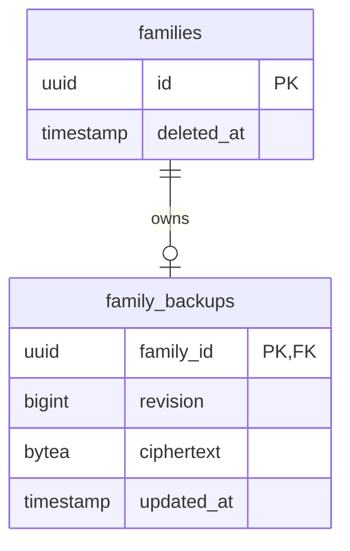
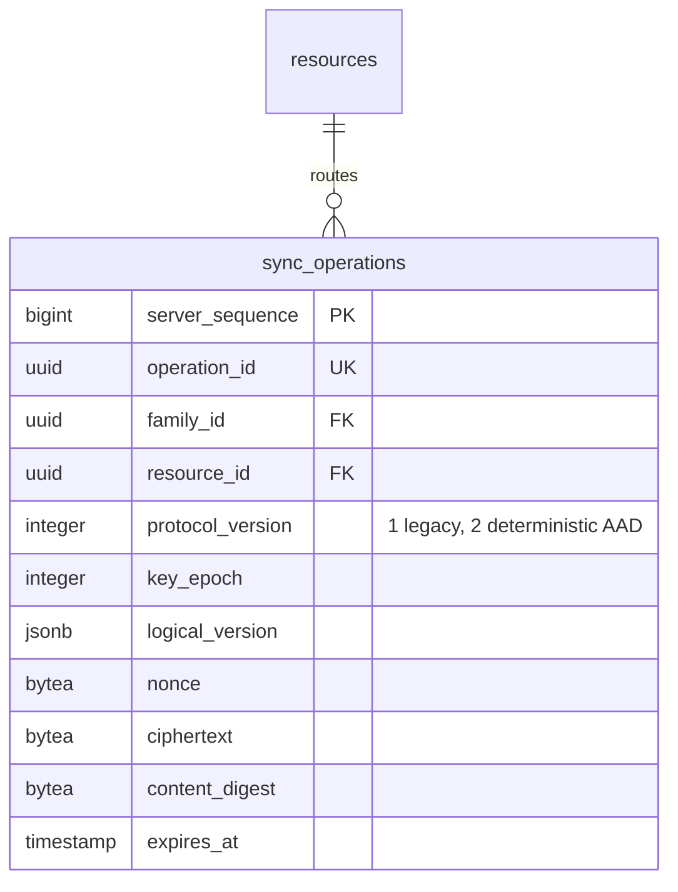

# PostgreSQL database

Migration `0001` creates `schema_metadata`. Migration `0002` creates:

| Area | Tables | Stored data |
| --- | --- | --- |
| Identity | `adults`, `webauthn_credentials`, `webauthn_challenges`, `sessions`, `devices` | Public credentials/keys, hashed tokens, expiry/state, counters |
| Tenant auth | `families`, `memberships`, `resources`, `resource_permissions`, `guardian_invitations` | Opaque UUIDs, roles, permission levels, hashed invite token, key epoch |
| Encryption relay | `resource_key_grants`, `sync_operations` | Signed sealed keys, authenticated routing metadata, opaque ciphertext, seven-day expiry |

Foreign keys, enum-like checks, unique invitation/operation constraints, positive
sequence/epoch constraints, and a partial unique index enforce one active device
per adult. Relay operations are indexed by family/server sequence and expiry.
The schema contains no family names, event titles, notes, child names, colours,
pickup details, reminders, or resource keys in decryptable form.

Migration `0003` adds opaque push tokens, hashed family email routing tokens,
and the initial suggestion table. Migration `0004` removes all email content
columns and adds `email_suggestion_deliveries`, which contains a recipient device
ID, libsodium sealed-box ciphertext, delivery state, and timestamps. The server
cannot decrypt these per-device payloads.

The migration suite upgrades a real PostgreSQL database, asserts schema version 6
and required tables, and exercises the constraints through the full API flow.

Migration `0005` adds `family_backups` (family UUID primary/foreign key, positive
revision, bounded v2 ciphertext, update timestamp). Family deletion cascades;
soft deletion triggers immediate snapshot removal. Retention is until replacement
or deletion, independently of seven-day synchronization retention. See
`../api/BACKUP-RECOVERY.md` for the opaque binary contract.

BUG-003 requires no PostgreSQL migration. The existing unique constraint
`uq_key_grant_recipient_epoch` permits exactly one sealed key per resource,
epoch and recipient. The API now returns exact retries and rejects conflicting
grants with 409, rather than violating this constraint. Resource-row locking
serializes epoch initialization and concurrent grant publication. Child creation
accepts a stable client UUID; names, colours and aliases remain absent from the
schema. Optional explicit owner consent inserts read permissions for active
calendar guardians only at first child provisioning. Retrying creation does not
expand those permissions to later guardians.

BUG-010 uses existing rows/columns; no migration. Adult-row and ordered resource
locks serialize replacement, scoped epoch increments and sync publication in
one transaction with device/session revocation. Resource keys remain absent.

Migration `0006` adds `sync_operations.protocol_version`, non-null/default 1,
constrained to 1 or 2. Existing nonce/ciphertext/digest/identity/sequence fields
are unchanged. Version participates in idempotency comparison. Downgrade is
blocked while version-2 ciphertext exists to prevent silent mislabeling.
Migration fixtures verify legacy bytes survive downgrade/upgrade and reject
unsafe removal. The destructive base-migration fixture explicitly discards its
test operations before teardown; production migration never discards ciphertext.

